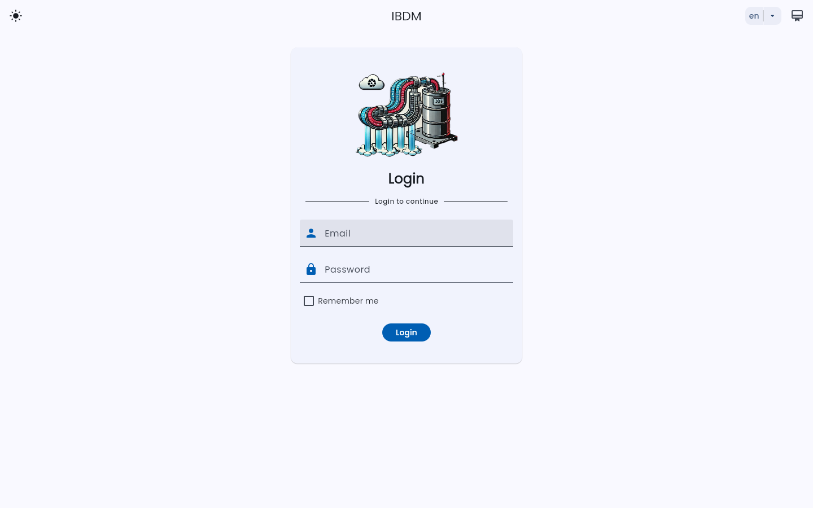

# IBDM — Industrial Data Monitoring Platform

End-of-studies project (PFE) developed during an internship at IFRI (Algeria): a cross-platform application that collects, stores and displays **industrial production data in real time** for several plant units (syrup room, filtration, utilities, CO₂).

## Architecture

```
Flutter app (web, Android, Windows, Linux, macOS, iOS)
        │  REST + WebSockets (typed client generated from OpenAPI)
        ▼
Django / DRF API  ──── Channels + Redis (live updates)
        │
        ├── SQL Server (one database per business domain)
        └── existing plant databases (automate, siroperie, filtration, utilité)
```

| Part | Path | Stack |
| --- | --- | --- |
| API | [backend/ibdm_api](backend/ibdm_api) | Python 3.12, Django 5, Django REST Framework, Channels (Daphne), drf-spectacular, `mssql-django` |
| App | [frontend/ibdm](frontend/ibdm) | Flutter / Dart, Retrofit client generated from the OpenAPI spec |
| Infrastructure | [backend/config](backend/config) | Docker Compose files for SQL Server, Redis, a MongoDB sharded cluster, and a local DNS/proxy |

### Django apps

| App | Role |
| --- | --- |
| `users`, `app_auth` | Users, permissions and authentication |
| `siroperie`, `filtration`, `utilite` | Plant units: models, REST endpoints and WebSocket consumers for live data |
| `automate` | Unmanaged models mapped onto the existing `automate` plant database |
| `documentation` | Serves the API docs |

## Features

- Real-time dashboards through WebSockets (Django Channels with a Redis channel layer)
- Role-based permissions and an admin back office (Jazzmin)
- Separate SQL Server databases per business domain
- Email reports with HTML templates (e.g. sugar inventory)
- Auto-generated OpenAPI documentation and Dart API client
- HTTPS-only deployment (Hypercorn + local certificate authority)

## Screenshots

Captured from the demo stack below (synthetic data).

| | |
| --- | --- |
|  |  |
| Login | Siroperie: live sugar tank levels |
|  |  |
| Filtration: flow, volume and pressure per line | CO₂ / N₂ levels and pressure gauges |
|  |  |
| User management | Server status: databases, Redis, memory |

The OpenAPI documentation is served by Swagger UI: 

## Try it with Docker (demo)

One command starts SQL Server, Redis and the API, creates the five databases, migrates them, creates the plant tables and seeds 20 hours of synthetic sensor readings. The API also serves the pre-built Flutter web app.

```bash
docker compose -f demo/compose.yaml up --build
```

Wait for `Databases ready` in the logs, then open <https://localhost:8443/app/> (accept the self-signed certificate) and log in with `admin@ibdm.demo` / `Demo_Passw0rd!`.

| URL | What |
| --- | --- |
| https://localhost:8443/app/ | Flutter web app (dashboards, user management, server status) |
| https://localhost:8443/api/v1/docs/ | Swagger UI |
| https://localhost:8443/admin | Django admin |

Everything under [demo](demo) is for local demonstration only: credentials are public and the TLS certificate is self-signed.

### Nix dev shell

```bash
nix develop          # Python 3.12, pipenv, ODBC Driver 18, docker compose, Node/pnpm
nix develop .#app    # Flutter toolchain for frontend/ibdm
```

## Getting started

### Prerequisites

Python 3.12, [pipenv](https://pipenv.pypa.io), pnpm, Docker, the [Flutter SDK](https://flutter.dev), and the Microsoft ODBC driver for SQL Server.

### Backend

```bash
pnpm run install:deps                       # pipenv sync
```

1. Start the databases and Redis from [backend/config/config/db](backend/config/config/db) (see its [README](backend/config/config/db/setup-README.md)); `pnpm run sql_server_db:up` starts SQL Server.
2. Create the environment file and fill in the real credentials:
   ```bash
   cp backend/.env.example backend/.env
   ```
3. Generate the HTTPS certificates ([instructions](backend/ibdm_api/certs/create_certificates.readme.md)).
4. Migrate and run:
   ```bash
   cd backend && pipenv run migrate
   pnpm run dev:server                      # https://localhost:8443
   ```

### Flutter app

```bash
cd frontend/ibdm
cp lib/config/api.config.dart.example lib/config/api.config.dart   # set the API URL
flutter pub get
flutter run -d chrome                       # or: android, windows, linux, macos
```

See [frontend/ibdm/README.md](frontend/ibdm/README.md) for Android certificate setup and release builds.

### Regenerate the API client

When the backend API changes:

```bash
pnpm run generate:api-client
```

This exports the OpenAPI schema, copies it to the Flutter project, fixes it for `swagger_parser`, and rebuilds the generated Dart client.

## API documentation

With the server running, open the interactive docs at `https://localhost:8443/api/documentation/` (Swagger UI; the exact route is set in the Django URL config), or read the committed spec at [backend/ibdm_api/openapi/openapi.spec.json](backend/ibdm_api/openapi/openapi.spec.json).

## License

Apache License 2.0 — see [LICENSE](LICENSE).
